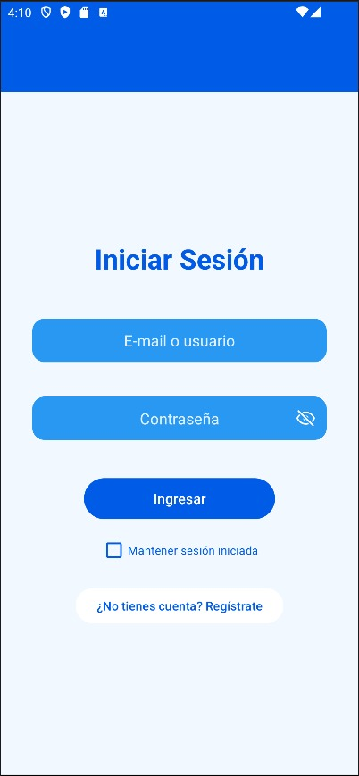
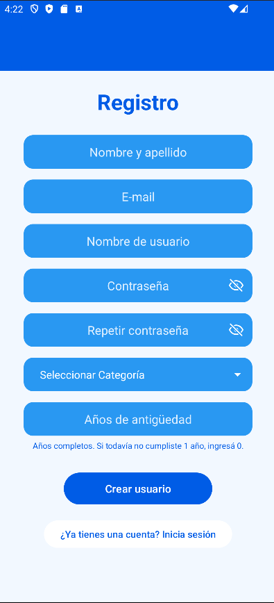
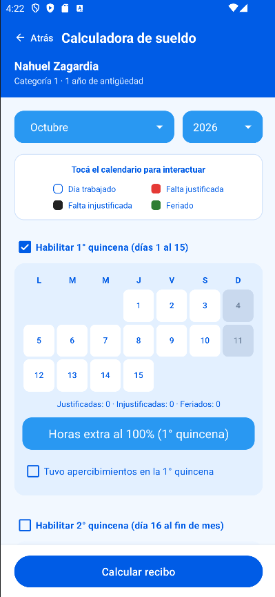
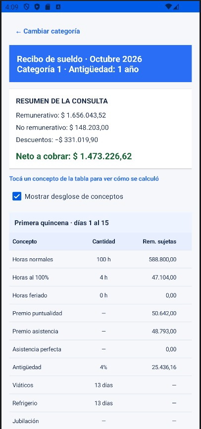
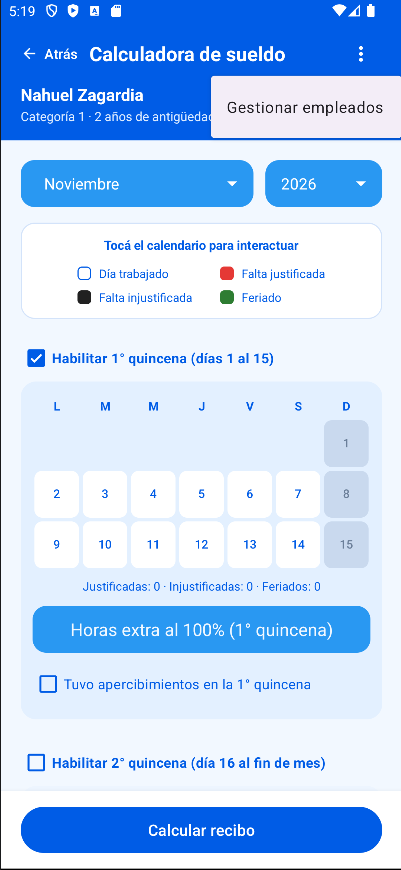
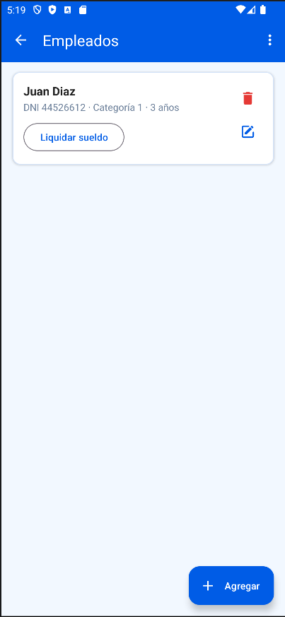
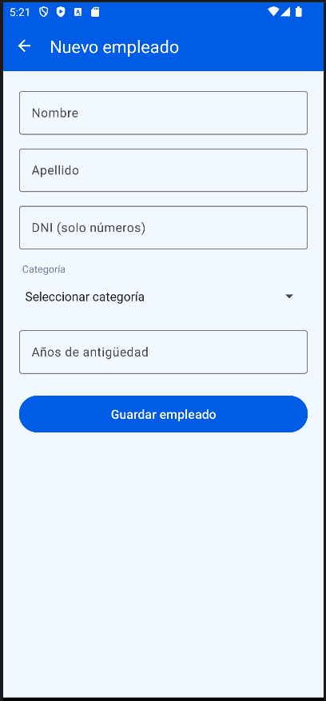
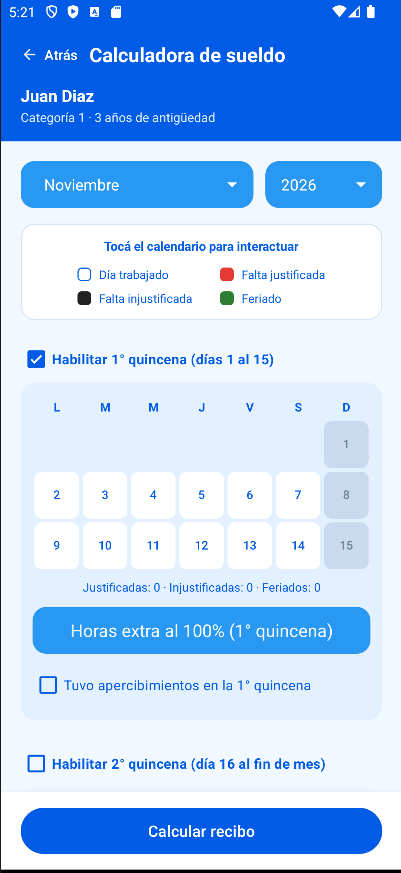
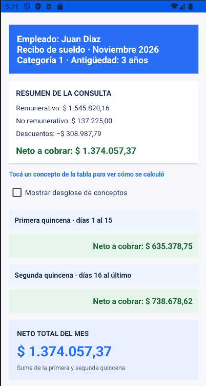

# Calculadora Salarial

Trabajos Prácticos 1 y 2 · Desarrollo Mobile · 2° / 1ra

Aplicación Android (Kotlin) pensada para los trabajadores del sindicato de lavaderos UOETSYLRA. Calcula el recibo de sueldo quincenal según la categoría, la antigüedad y los días que se marcan en el calendario.

La app se armó en dos partes:

- **TP 1, Calculadora salarial:** registro, login, calculadora y recibo. Está en las secciones desde «Qué hace la app» hasta «Reglas de liquidación».
- **TP 2, Gestión de empleados (RRHH):** alta, modificación, baja y listado de empleados con una base de datos Room, y liquidación del sueldo de cada uno. Está en la sección «TP 2: Gestión de empleados».

## Integrantes

- Nahuel Zagardía
- Valeria García
- Benjamin Eluza
- Rocío Madrid

## Qué hace la app

1. El usuario se **registra** con nombre, mail, usuario, contraseña, años de antigüedad y categoría.
2. **Inicia sesión** con su mail o su usuario (puede dejar la sesión guardada).
3. En la **calculadora** elige mes y año, y marca en dos calendarios (primera y segunda quincena) cómo fue cada día.
4. Con **Calcular recibo** ve el detalle de cada quincena y el total del mes. Tocando cada concepto se abre una explicación de cómo se calculó.

## Pantallas

| Pantalla | Archivo | Qué hace |
|---|---|---|
| Login | `MainActivity.kt` | Inicio de sesión y acceso al registro |
| Registro | `RegistroActivity.kt` | Alta del usuario y validación de los datos |
| Calculadora | `CalculadoraActivity.kt` | Calendarios, horas extra, apercibimientos |
| Recibo | `ReciboActivity.kt` | Detalle de la liquidación, guardar y compartir |

Otros archivos importantes:

- `Liquidacion.kt`: el motor que hace las cuentas (escalas y reglas).
- `RepositorioUsuarios.kt`: guarda usuarios y sesión en el celular (SharedPreferences).
- `ExplicacionConceptoFragment.kt` y `ExplicacionRecibo.kt`: las explicaciones de cada concepto.
- `Utilidades.kt`: formato de fechas y dinero, y funciones de ayuda.

## Capturas

### 1. Inicio de sesión

Se entra con el e-mail o el nombre de usuario. El ícono del ojo, dentro del campo, muestra u oculta la contraseña. La casilla "Mantener sesión iniciada" guarda la sesión en el celular, y desde acá también se llega al registro.

### 2. Registro

Alta del empleado con nombre y apellido, e-mail, nombre de usuario, contraseña (con confirmación), categoría y años de antigüedad. Todos los campos se validan antes de crear el usuario.

### 3. Calculadora

Arriba figuran el nombre, la categoría y la antigüedad del empleado. Se elige el mes y el año, y se marca cada día del calendario de la quincena con los cuatro estados de la leyenda: día trabajado, falta justificada, falta injustificada y feriado. También se pueden cargar horas extra al 100 % y tildar si hubo apercibimientos. El botón "Atrás" vuelve al login.

### 4. Recibo de sueldo

Muestra el resumen de la consulta (remunerativo, no remunerativo, descuentos y neto a cobrar) y el desglose de cada quincena, concepto por concepto. Desde "Cambiar categoría" se recalcula el recibo con otra categoría.

## Cómo usar el calendario

- **Tocar un día** cambia su estado en este orden: trabajado → falta justificada → falta injustificada → trabajado.
- **Mantener apretado un día** lo marca como **feriado trabajado** (se paga doble). Si se mantiene apretado de nuevo, vuelve a trabajado.
- Los domingos no se cuentan.

| Estado | Qué pasa en el recibo |
|---|---|
| Trabajado | Se pagan las horas simples, con viático y refrigerio |
| Falta justificada | Se pagan las horas simples, sin viático |
| Falta injustificada | No se paga, y se pierde asistencia y puntualidad (y el premio de asistencia perfecta del mes) |
| Feriado trabajado | 8 horas simples + 8 horas al 100 %. El viático y el refrigerio se pagan una sola vez |

Los sábados se pagan 6 horas normales y 2 horas al 100 %.

## Reglas de liquidación

**Escala por categoría:**

| Categoría | Valor hora | Asistencia | Puntualidad | Asistencia perfecta |
|---|---|---|---|---|
| Inicial | $5.379 | $47.332 | $49.174 | $71.015 |
| Categoría 1 | $5.888 | $48.793 | $50.642 | $73.258 |
| Categoría 2 | $6.120 | $49.847 | $54.450 | $75.708 |
| Categoría 3 | $6.374 | $50.826 | $55.548 | $77.521 |
| Categoría 4 | $6.620 | $51.871 | $57.300 | $79.470 |

Viático: $3.123 · Refrigerio: $2.366 (no son remunerativos).

**Antigüedad:**

- Menos de 1 año: 0 %.
- De 1 a 4 años: 4 %.
- 5 años o más: 1 % por cada año.

**Premios:**

- La *asistencia perfecta* se paga solo en la segunda quincena, si todo el mes estuvo limpio.
- Un *apercibimiento* en una quincena hace perder la puntualidad y la asistencia perfecta.

**Descuentos** (solo sobre lo remunerativo): 10,9961 %, 2,9985 %, 2,9985 %, 0,9985 % y 1,9970 %, que suman 19,9886 %.

Todos los importes se redondean a centavos.

### Ejemplo de prueba

Octubre 2026 · Categoría 2 · 6 años de antigüedad · día 5 falta justificada · día 12 feriado · día 20 falta injustificada:

- Primera quincena: **$751.415,44**
- Segunda quincena: **$642.311,94**
- Total del mes: **$1.393.727,38**

## TP 2: Gestión de empleados

En el TP 2 se agregó a la misma app una sección para **administrar a los empleados**, guardados en una base de datos **Room**. Se ingresa desde el menú (superior derecha) de la calculadora, en **Gestionar empleados**. Cada empleado tiene nombre, apellido, DNI, categoría y años de antigüedad.

### Qué se agregó

- **Listado:** una tarjeta por empleado, ordenada por apellido y nombre. Si todavía no hay ninguno, la pantalla lo avisa.
- **Alta:** el botón **Agregar** abre un formulario que valida los datos (nombre y apellido, DNI, categoría y antigüedad) y no deja repetir el DNI.
- **Modificación:** el icono lápiz de la tarjeta abre el mismo formulario con los datos cargados.
- **Baja:** el icono "tacho" elimina a un empleado, con confirmación. El menú de la barra tiene **Eliminar todos**, también con confirmación.
- **Liquidar sueldo:** el botón de cada tarjeta abre la calculadora del TP 1 con la categoría y la antigüedad del empleado ya cargadas. El recibo lleva su nombre y se calcula con el mismo motor del TP 1.

### Capturas del TP 2

#### Menú de la calculadora

Desde la calculadora, el menú ⋮ de arriba a la derecha tiene la opción «Gestionar empleados», que abre la sección del TP 2.

#### Lista de empleados

Cada empleado es una tarjeta con su nombre, DNI, categoría y años de antigüedad. El botón «Liquidar sueldo» abre la calculadora con sus datos, el tacho lo elimina y el lápiz lo modifica. El botón «Agregar» carga un empleado nuevo y la flecha de arriba vuelve a la calculadora.

#### Alta de un empleado

El botón «Agregar» abre el formulario «Nuevo empleado»: nombre, apellido, DNI, categoría y años de antigüedad. Antes de guardar se validan los datos y no se permite repetir el DNI. Para modificar a un empleado se usa este mismo formulario, ya cargado con sus datos.

#### Calculadora en modo empleado

«Liquidar sueldo» abre la calculadora con el nombre, la categoría y la antigüedad del empleado ya cargados. En este modo no aparece el menú y «Atrás» vuelve a la lista de empleados.

#### Recibo del empleado

El recibo lleva arriba el nombre del empleado y se calcula con el mismo motor del TP 1. No muestra «Cambiar categoría», porque la categoría es la del empleado.

## Tecnologías

- Kotlin y Android Views (XML)
- Material Design 3
- SharedPreferences para usuarios y sesión (contraseñas con hash PBKDF2 y sal)
- Room, con KSP, para los empleados (TP 2)
- Fragments y Navigation Component (TP 2)
- MVVM con ViewModel, LiveData y corrutinas (TP 2)
- RecyclerView y ViewBinding (TP 2)
- Gradle con Kotlin DSL
